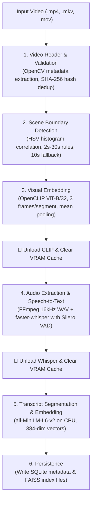
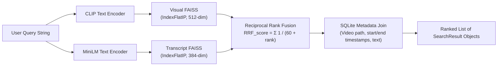

# VideoSDK 🎥🔍

> **Search inside videos by what is said and what is seen. Fully offline.**

[](https://github.com/harshit/videosdk/actions/workflows/ci.yml)
[](https://www.python.org/downloads/)
[](LICENSE)
[](https://github.com/astral-sh/ruff)
[](http://mypy-lang.org/)
[](#hardware-requirements--limits)

---

## 📖 Table of Contents

- [Overview](#-overview)
- [Why VideoSDK?](#-why-videosdk)
- [Key Features](#-key-features)
- [System Architecture](#-system-architecture)
  - [Indexing Pipeline](#indexing-pipeline)
  - [Search & Fusion Pipeline](#search--fusion-pipeline)
  - [Planned Project Layout](#planned-project-layout)
  - [On-Disk Index Format](#on-disk-index-format)
- [Tech Stack](#-tech-stack)
- [Hardware Requirements & Limits](#-hardware-requirements--limits)
- [Installation & Setup](#-installation--setup)
  - [Prerequisites](#prerequisites)
  - [Clone & Virtual Environment](#1-clone-and-create-environment)
  - [Install Dependencies](#2-install-dependencies)
  - [GPU Acceleration (Optional)](#3-gpu-acceleration-optional)
  - [Verify Environment](#4-verify-environment)
- [Quickstart Guide](#-quickstart-guide)
  - [Python API](#python-api)
  - [Command-Line Interface (CLI)](#command-line-interface-cli)
  - [Running the Phase 1 Prototype Demo](#running-the-prototype-demo)
- [Roadmap & Development Tracker](#-roadmap--development-tracker)
- [Development & Testing](#-development--testing)
  - [Running Unit Tests](#running-tests)
  - [Code Quality & Linting](#code-quality--linting)
- [Contributing](#-contributing)
  - [Workflow](#contribution-workflow)
  - [Coding Standards](#coding-standards)
- [License & Attributions](#-license--attributions)

---

## 🌟 Overview

**VideoSDK** is an embedded, lightweight Python library and CLI designed to semantically index and search video collections completely offline. By pairing visual frame embeddings with speech-to-text transcript retrieval, VideoSDK allows you to query long-form videos using everyday natural language (e.g., *"where is gradient descent explained?"* or *"red sports car drifting"*).

Unlike cloud-dependent video search services, VideoSDK requires **no external API keys**, transmits **zero private footage**, and runs efficiently on everyday consumer hardware (including laptops with a modest **4 GB GPU** or purely on **CPU**).

```
"show me the diagram of the neural network"
                  │
         ┌────────┴────────┐
         ▼                 ▼
   [Visual Match]    [Speech Match]
   OpenCLIP ViT-B/32 faster-whisper + MiniLM
         │                 │
         └────────┬────────┘
                  ▼
      Reciprocal Rank Fusion (RRF)
                  │
                  ▼
  🏆 Timestamp 14:28 | Score 0.032 | "Here is the network architecture..."
  ✂️ Instant Clip Extraction via FFmpeg
```

---

## 💡 Why VideoSDK?

1. **Videos are Black Boxes:** Finding a specific concept or visual moment traditionally means scrubbing hours of footage by hand.
2. **Cloud APIs are Costly and Intrusive:** Enterprise multimodal search platforms charge recurring per-minute indexing fees and require uploading sensitive video data to third-party clouds.
3. **Open-Source Tooling is Fragmented:** Most repositories are one-off tutorial scripts that combine Whisper and CLIP in an in-memory loop, rather than offering a structured, reusable library with robust metadata and vector persistence.
4. **Heavy VRAM Demands:** State-of-the-art vision-language models typically require 16 GB to 24 GB VRAM. VideoSDK is engineered from the ground up for a **4 GB VRAM ceiling** through strict **sequential model execution** and proactive memory freeing.

---

## ✨ Key Features

- 🧠 **Dual-Modal Semantic Search:** Search by visual scenes (`mode="visual"`), spoken audio (`mode="speech"`), or rank both simultaneously (`mode="both"`).
- 🔀 **Reciprocal Rank Fusion (RRF):** Merges visual and speech rankings using scale-invariant RRF ($k=60$), eliminating arbitrary score-weight tuning.
- ⚡ **Sequential Memory Architecture:** OpenCLIP, Whisper, and Sentence-Transformers never share GPU memory simultaneously. Each model is loaded on demand and fully evicted before the next stage.
- 🛡️ **OOM Resilience:** Automatic out-of-memory retry handler that dynamically halves batch sizes and falls back to CPU if hardware memory is saturated.
- 🎬 **Intelligent Scene Segmentation:** Fast HSV histogram correlation identifies natural cut boundaries, enforced by duration guards (minimum 2s, maximum 30s) and static-lecture fallbacks (fixed 10s windows).
- 🎙️ **Hallucination-Resistant Speech Transcription:** `faster-whisper` integrated with Silero Voice Activity Detection (VAD) automatically skips silence and filters low-confidence artifacts (`avg_logprob < -1.0`).
- ✂️ **Sub-Second Video Clipping:** Instantly export matched highlights using FFmpeg stream copying without re-encoding delays.
- 📦 **Embedded Storage:** Self-contained file-based storage using SQLite for structured metadata and FAISS (`IndexFlatIP`) for vector similarity. Zero external database servers required.

---

## 🏗️ System Architecture

### Indexing Pipeline

When indexing a video via `index.add("video.mp4")`, the pipeline runs through sequential, memory-isolated stages:



### Search & Fusion Pipeline

When running `index.search("query", mode="both", top_k=5)`:



---

### 📂 Planned Project Layout

The repository is modularized with clean separation between video processing, machine learning models, storage backends, and search fusion:

```
VIDgen/
├── pyproject.toml              # Build config, dependencies, ruff/mypy/pytest settings
├── README.md                   # Project documentation and quickstart
├── LICENSE                     # MIT License
├── PROJECT_OVERVIEW.md         # Source of truth specification and requirements
├── IMPLEMENTATION_GUIDE.md     # Detailed architectural and implementation reference
├── TRACKER.md                  # Milestone, phase, and engineering decision log
├── notes.md                    # Working notes and module references
│
├── .github/
│   └── workflows/
│       └── ci.yml              # GitHub Actions CI matrix (Python 3.10, 3.11, 3.12)
│
├── src/videosdk/               # Core VideoSDK library package
│   ├── __init__.py             # Exports VideoIndex and version
│   ├── index.py                # Public VideoIndex facade (add, search, list, remove)
│   ├── types.py                # Dataclasses: VideoMeta, SearchResult
│   ├── config.py               # Hyperparameters, thresholds, and model configurations
│   ├── errors.py               # Explicit exception hierarchy
│   │
│   ├── video/                  # Video ingest and manipulation
│   │   ├── reader.py           # Streamed frame reader, seeking, and metadata extraction
│   │   ├── scenes.py           # HSV histogram scene detection & segmentation logic
│   │   └── clipper.py          # Fast FFmpeg stream-copy video cutter
│   │
│   ├── models/                 # Deep learning model wrappers (isolated life cycles)
│   │   ├── memory.py           # Device detection, GPU memory tracking, and OOM retry
│   │   ├── clip_encoder.py     # OpenCLIP image & text encoder wrapper
│   │   ├── asr.py              # faster-whisper ASR wrapper with VAD filtering
│   │   └── text_encoder.py     # sentence-transformers (all-MiniLM-L6-v2) wrapper
│   │
│   ├── store/                  # On-disk indexing and persistence
│   │   ├── vectors.py          # FAISS IndexFlatIP vector storage and similarity search
│   │   └── metadata.py         # SQLite storage for video records, segments, and text
│   │
│   ├── search/                 # Cross-modal query resolution
│   │   ├── fusion.py           # Reciprocal Rank Fusion (RRF) algorithm
│   │   └── searcher.py         # Search coordinator for visual, speech, and fusion modes
│   │
│   └── cli.py                  # Typer-powered command-line interface
│
├── tests/                      # Comprehensive test suite
│   ├── test_reader.py          # Video metadata and frame streaming tests
│   ├── test_scenes.py          # Scene boundary detection and fallback rule tests
│   ├── test_clip_encoder.py    # OpenCLIP embedding and normalization tests
│   ├── test_store.py           # FAISS and SQLite persistence tests
│   ├── test_fusion.py          # RRF ranking verification tests
│   ├── test_api.py             # Public VideoIndex end-to-end API tests
│   └── data/                   # Synthetic test videos and fixtures
│
├── benchmarks/                 # Reproducible performance and evaluation suite
│   ├── run_benchmark.py        # Benchmark harness (speed, memory, Recall@K, MRR)
│   ├── eval_set/               # Evaluation video registry and ground-truth labels
│   └── results/                # Measured runtime and accuracy tables
│
├── examples/                   # Practical guides and runnable examples
│   ├── visual_search_demo.py   # Standalone visual search prototype script
│   └── demo.ipynb              # Interactive Jupyter notebook walkthrough
│
└── scripts/                    # Developer utility scripts
    └── check_gpu.py            # Local CUDA and VRAM sanity verification tool
```

---

### 💾 On-Disk Index Format

When VideoSDK creates an index folder (e.g. `my_index/`), it organizes storage into a self-contained directory:

```
my_index/
├── index.json      # Metadata: schema_version, model configurations, created timestamp
├── meta.sqlite     # SQLite database storing video catalog and segment records
├── visual.faiss    # FAISS IndexFlatIP holding 512-dim visual embeddings
└── text.faiss      # FAISS IndexFlatIP holding 384-dim transcript embeddings
```

#### SQLite Schema

```sql
CREATE TABLE videos (
    video_id    INTEGER PRIMARY KEY AUTOINCREMENT,
    file_path   TEXT NOT NULL UNIQUE,
    file_hash   TEXT NOT NULL,        -- SHA-256 for instant deduplication
    duration    REAL NOT NULL,        -- Duration in seconds
    fps         REAL NOT NULL,
    width       INTEGER NOT NULL,
    height      INTEGER NOT NULL,
    added_at    TEXT NOT NULL         -- ISO-8601 timestamp
);

CREATE TABLE segments (
    segment_id      INTEGER PRIMARY KEY AUTOINCREMENT,
    video_id        INTEGER NOT NULL REFERENCES videos(video_id) ON DELETE CASCADE,
    start_time      REAL NOT NULL,    -- Segment start (seconds)
    end_time        REAL NOT NULL,    -- Segment end (seconds)
    transcript_text TEXT DEFAULT '',  -- Spoken text in this time window
    visual_index_id INTEGER NOT NULL, -- Row index in visual.faiss
    text_index_id   INTEGER DEFAULT -1, -- Row index in text.faiss (-1 if silent)
    UNIQUE(video_id, start_time)
);
```

---

## 🛠️ Tech Stack

| Component | Technology | Rationale |
|---|---|---|
| **Core Language** | Python 3.10+ | Standard ecosystem for machine learning and computer vision. |
| **Video Decoding & Scenes** | OpenCV (`opencv-python-headless`) | Fast lazy frame sampling; HSV histogram correlation for scene cuts. |
| **Media Operations** | FFmpeg (system binary) | Instant stream-copy clipping (`-c copy`) and 16 kHz audio extraction. |
| **Visual Embeddings** | OpenCLIP (`ViT-B-32`) | Lightweight (~150 MB weights, ~600 MB VRAM in fp16); shared vision-text space. |
| **Speech-to-Text** | `faster-whisper` (`base`) | Up to 4× faster than vanilla Whisper; CTranslate2 int8 quantization with Silero VAD. |
| **Transcript Embeddings**| `sentence-transformers` (`all-MiniLM-L6-v2`) | Compact 384-dim embeddings (~80 MB); executes swiftly on CPU. |
| **Vector Index** | FAISS (`faiss-cpu`) | Sub-millisecond exact cosine search (`IndexFlatIP`); 0 MB GPU footprint. |
| **Metadata Storage** | SQLite (`sqlite3`) | Embedded, serverless, atomic, single-file relational storage. |
| **CLI Framework** | Typer + Rich | Strictly typed commands, automated help menus, and progress formatting. |
| **Quality & Tooling** | Ruff, Mypy, Pytest | Enforces type safety, PEP standards, and comprehensive test coverage. |

---

## ⚙️ Hardware Requirements & Limits

VideoSDK is engineered for everyday development setups:

| Spec | Recommended GPU Setup | Minimum CPU Fallback Setup |
|---|---|---|
| **Processor** | Modern x86-64 CPU (4+ cores) | Modern x86-64 or Apple Silicon CPU |
| **RAM** | 8 GB RAM | 8 GB RAM |
| **GPU / VRAM** | NVIDIA GPU with **4 GB VRAM** (e.g., RTX 3050 Laptop) | None (pure CPU execution) |
| **Disk Space** | ~2 GB free (models and indexes) | ~2 GB free |
| **OS** | Linux, macOS, or Windows 10/11 | Linux, macOS, or Windows 10/11 |

> [!NOTE]
> **Sequential Memory Guarantee:**
> Peak GPU memory usage is capped at approximately **1.4 GB to 1.8 GB VRAM** during visual encoding, and **~600 MB to 900 MB VRAM** during speech transcription. If an unexpected OOM occurs, VideoSDK catches the exception, reduces the batch size, or seamlessly falls back to CPU.

---

## 🚀 Installation & Setup

### Prerequisites

1. **Python 3.10 or higher**
2. **FFmpeg installed and available on system `PATH`**:
   - **Linux (Ubuntu/Debian):** `sudo apt update && sudo apt install -y ffmpeg`
   - **macOS (Homebrew):** `brew install ffmpeg`
   - **Windows (winget / Chocolatey):** `winget install Gyan.FFmpeg` or `choco install ffmpeg`

Verify FFmpeg in your terminal:
```bash
ffmpeg -version
```

---

### 1. Clone and Create Environment

```bash
# Clone the repository
git clone https://github.com/harshit/videosdk.git
cd videosdk

# Create and activate virtual environment
python -m venv .venv

# On Linux/macOS:
source .venv/bin/activate

# On Windows (PowerShell):
.venv\Scripts\Activate.ps1
```

---

### 2. Install Dependencies

Install the core SDK along with development dependencies:

```bash
pip install --upgrade pip
pip install -e ".[dev]"
```

---

### 3. GPU Acceleration (Optional)

By default, PyTorch may install a CPU-only binary. If you have an NVIDIA GPU (e.g. RTX 3050), install the CUDA-enabled build:

```bash
# For CUDA 12.1:
pip install torch torchvision --index-url https://download.pytorch.org/whl/cu121

# For CUDA 11.8:
pip install torch torchvision --index-url https://download.pytorch.org/whl/cu118
```

---

### 4. Verify Environment

Run the bundled diagnostic script to check available compute devices and memory:

```bash
python scripts/check_gpu.py
```

Expected output:
```text
=== GPU & System Memory Check ===
Python version  : 3.10.x / 3.11.x
PyTorch version : 2.x.x
CUDA available  : True
Device name     : NVIDIA GeForce RTX 3050 Laptop GPU
Total VRAM      : 4096.0 MB
Free VRAM       : 3450.0 MB
Allocated VRAM  : 0.0 MB
=================================
```

---

## ⚡ Quickstart Guide

### Python API

The primary interface is [`VideoIndex`](src/videosdk/index.py):

```python
from videosdk import VideoIndex

# 1. Initialize or open an index directory
index = VideoIndex(index_dir="my_index", device="auto")  # "auto" | "cuda" | "cpu"

# 2. Add video files to index (extracts scenes, embeds visuals, transcribes audio)
index.add("lectures/cs101_lecture1.mp4")
index.add("lectures/cs101_lecture2.mp4")

# 3. Perform a semantic search
# Modes: "both" (visual + speech fusion), "visual" (visual only), "speech" (transcript only)
results = index.search(
    query="where is backpropagation explained on the whiteboard?",
    top_k=5,
    mode="both"
)

# 4. Inspect ranked matches
for rank, match in enumerate(results, start=1):
    print(f"#{rank} [{match.timestamp}] Score: {match.score:.4f} (Source: {match.source})")
    print(f"   Video: {match.video} ({match.start:.1f}s - {match.end:.1f}s)")
    if match.text:
        print(f"   Spoken: \"{match.text}\"")

# 5. Extract an instant highlight clip of the top match
best_match = results[0]
best_match.clip("highlights/backprop_explanation.mp4")
print("Saved highlight clip successfully!")

# 6. Index management utilities
indexed_videos = index.list_videos()
print("Currently indexed videos:", indexed_videos)

# Remove a video and all associated segments/vectors
index.remove("lectures/cs101_lecture2.mp4")
```

#### Result Object Structure

Every item in `results` is an instance of [`SearchResult`](src/videosdk/types.py):

| Attribute | Type | Description |
|---|---|---|
| `video` | `str` | Absolute or relative path to the original video file. |
| `start` | `float` | Start offset of the matching segment in seconds. |
| `end` | `float` | End offset of the matching segment in seconds. |
| `timestamp` | `str` | Human-readable timestamp string (`"MM:SS"` or `"H:MM:SS"`). |
| `score` | `float` | Computed relevance score (higher is more relevant). |
| `text` | `str` | Transcript text spoken during this segment (if any). |
| `source` | `str` | Retrieval origin: `"visual"`, `"speech"`, or `"both"`. |
| `clip(path)` | `Callable` | Extracts the segment into `path` using FFmpeg stream copy. |

---

### Command-Line Interface (CLI)

VideoSDK features a complete CLI via `videosdk`:

```bash
# Add a video to an index
videosdk add my_index ./recordings/presentation.mp4

# Search an index
videosdk search my_index "quantum computing principles" --top-k 5 --mode both

# Search visual content only
videosdk search my_index "cat jumping on table" --mode visual

# Search spoken transcripts only
videosdk search my_index "quarterly earnings projection" --mode speech

# List all indexed videos
videosdk list my_index

# Remove a video from the index
videosdk remove my_index ./recordings/presentation.mp4
```

---

### Running the Prototype Demo

To test visual search independently on any video file:

```bash
python examples/visual_search_demo.py path/to/sample_video.mp4 "person presenting a slide"
```

---

## 🗺️ Roadmap & Development Tracker

Development progress is tracked across 6 discrete phases as detailed in [TRACKER.md](TRACKER.md):

| Phase | Milestone | Focus Areas | Status |
|:---:|---|---|:---:|
| **0** | **Setup & Foundation** | Repo structure, packaging (`pyproject.toml`), CI workflow, GPU memory utils | ✅ Completed |
| **1** | **Visual Search Prototype** | OpenCV reader, HSV scene detection, OpenCLIP embedding, FAISS index | ✅ Completed |
| **2** | **Speech Search** | FFmpeg audio extraction, `faster-whisper` + VAD, MiniLM embeddings, SQLite | 🔄 In Progress |
| **3** | **Multimodal Fusion** | Reciprocal Rank Fusion (RRF), cross-modal coordinator, typed search results | 📅 Planned |
| **4** | **Public SDK & CLI** | `VideoIndex` class, Typer CLI commands, error management, docstrings | 📅 Planned |
| **5** | **Evaluation & Benchmarks**| Ground-truth evaluation set, Recall@1/5, MRR, speed/memory profiling | 📅 Planned |
| **6** | **Release & Distribution** | PyPI publishing, demo notebook, full documentation | 📅 Planned |

---

## 🧪 Development & Testing

### Running Tests

We use `pytest` for unit and integration testing. Run tests locally:

```bash
# Set PYTHONPATH to include src/
# Linux / macOS:
PYTHONPATH=src pytest

# Windows (PowerShell):
$env:PYTHONPATH="src"; pytest
```

Run specific test modules:
```bash
$env:PYTHONPATH="src"; pytest tests/test_scenes.py tests/test_reader.py
```

### Code Quality & Linting

All contributions must pass strict Ruff linting and Mypy static type checking:

```bash
# Run Ruff linting
ruff check src/ tests/

# Run Ruff code formatting check
ruff format --check src/ tests/

# Run Mypy static type checking
mypy src/videosdk/
```

---

## 🤝 Contributing

We welcome community contributions! Please follow these steps:

### Contribution Workflow

1. **Fork the Repository:** Create a personal fork on GitHub.
2. **Create a Feature Branch:**
   ```bash
   git checkout -b feature/your-feature-name
   ```
3. **Set Up Development Environment:**
   ```bash
   pip install -e ".[dev]"
   ```
4. **Implement Your Changes:**
   - Write clean, self-documenting code with comprehensive type hints.
   - Maintain the **sequential model loading rule** to protect the 4 GB VRAM limit.
   - Add unit tests under `tests/` for all newly introduced functionality.
5. **Verify Quality Checks:**
   ```bash
   ruff check src/ tests/
   mypy src/videosdk/
   pytest
   ```
6. **Submit a Pull Request:** Open a PR against `main` describing your changes, motivation, and test verification results.

### Coding Standards

- **Type Annotations:** All public classes and functions must include full type signatures.
- **Explicit Exceptions:** Avoid raw standard exceptions; raise custom exceptions from [`videosdk.errors`](src/videosdk/errors.py) with helpful recovery messages.
- **Memory Responsibility:** Never leave models or large tensors resident on the GPU outside active inference routines. Always call `unload_model()` and clean caches.

---

## 📄 License & Attributions

This project is licensed under the **MIT License** — see the [LICENSE](LICENSE) file for details.

### Acknowledgements & Open-Source Models

VideoSDK is built upon outstanding open-source models and foundational tools:
- **[OpenCLIP](https://github.com/mlfoundations/open_clip)** (`ViT-B-32`): Visual and text joint embedding models trained on LAION-2B.
- **[faster-whisper](https://github.com/SYSTRAN/faster-whisper)**: CTranslate2 reimplementation of OpenAI Whisper with Silero VAD integration.
- **[Sentence-Transformers](https://sbert.net/)** (`all-MiniLM-L6-v2`): High-efficiency semantic sentence embeddings.
- **[FAISS](https://github.com/facebookresearch/faiss)**: Fast nearest neighbor vector indexing by Meta AI.
- **[OpenCV](https://opencv.org/)**: Computer vision framework for real-time video decoding and histogram analysis.
- **[FFmpeg](https://ffmpeg.org/)**: The universal media processing toolkit.
